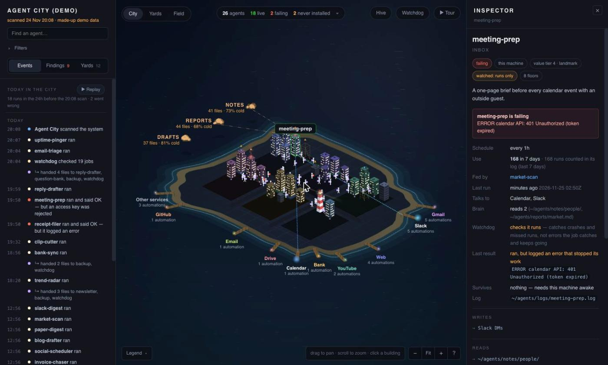

# Agent City

Your automations, drawn as a city you can fly over and question.



Every building is one agent, cron job or service. Lit windows mean it ran recently.
Smoke means it is failing. Scaffolding means you built it and never switched it on.
Walkers carry files from the agent that writes them to the agent that reads them.
Clouds are the folders your agents share, and rain shows who reads what.

The point is not the picture. Once you run more than a handful of agents, the hard
part is noticing the one that quietly stopped three weeks ago, or the one that
exits 0 every hour while logging `401 Unauthorized`. In a city, a dead job *looks*
dead from across the room.

- One HTML file. No server, no database, no account.
- Python 3.9+ (the one that ships with macOS works), standard library only. Nothing to install.
- It only reads. The scan never changes a job, a crontab or a file outside this folder.

## Try the demo (30 seconds)

```bash
git clone https://github.com/zakkonanz-creator/agent-city.git
cd agent-city
python3 build.py --demo --open
```

That builds a made-up city of 26 agents from fake logs, through the same scanner your
own city will use, and opens it in your browser.

## Map your own agents

1. **Copy the example config.**
   ```bash
   cp examples/agents.example.toml agents.toml
   ```
   `agents.toml` is git-ignored, so your setup stays on your machine.

2. **List your agents.** Each `[[agent]]` needs an `id`. Everything else is optional,
   but the more you say about where to look, the more the city can tell you:

   ```toml
   [[agent]]
   id = "email-triage"
   district = "inbox"
   purpose = "Sorts new email and writes a shortlist."
   cron = "email_triage.py"            # proves it's installed, gives the schedule
   log = "~/agents/logs/email-triage.log"
   run_marker = "=== run start"        # counts runs, scopes errors to the latest run
   writes = ["~/agents/notes/inbox/triage.md"]
   talks_to = ["Gmail"]
   tier = 4
   ```

3. **Scan and build.**
   ```bash
   python3 scan.py           # reads the machine -> data/city.json
   python3 build.py --open   # -> dist/index.html
   ```

4. **Read the findings.** The left rail lists what needs a decision (failing, gone
   quiet), what's quietly broken, and what's worth knowing. Click one to fly to the
   building.

5. **Fill in the gaps it points out.** "Cannot tell whether X runs" means it needs a
   `log`, a `health_url` or a `check`. "N jobs running that are not on the map" means
   your crontab has jobs you haven't listed.

**Shortcut:** let Claude Code write the first draft. In the folder where your agents
live, run `claude` and paste:

> Read examples/agents.example.toml from ~/agent-city (or wherever you cloned it). Then look at my
> crontab, my launchd agents / systemd timers, and the scripts and logs in this folder, and write
> ~/agent-city/agents.toml with one [[agent]] per job: id, district, a one-line purpose, how to
> find it (cron / launchd / systemd), its log, a run_marker if its log has one, and what it reads
> and writes. Don't guess a log path you can't see; leave it out and tell me.

## What each probe reads

| Key | Reads | Tells the city |
|---|---|---|
| `cron` | `crontab -l` (or the host's, over ssh) | installed or not, and the schedule |
| `launchd` | `launchctl list`, `~/Library/LaunchAgents/<label>.plist` | installed, loaded, last exit code, schedule |
| `systemd` | `systemctl --user show <unit>` | installed, active, last result and exit code |
| `log` / `error_log` | file mtime, size and tail (globs pick the newest) | last run, errors in the latest run, runs per week |
| `health_url` | an HTTP GET | up if 2xx/3xx |
| `check` | any shell command you write | healthy if it exits 0 |
| `process` | `ps` | a resident job is actually running |
| `host` | `[hosts.<name>] ssh = "user@host"` | runs the cron, log and ps probes on another machine in one ssh call |

### How a building gets its state

In order, first match wins:

1. `paused` in the config → **paused** (shuttered, never counted as broken)
2. past its `until` date → **dormant**
3. its host didn't answer over ssh → **unknown**
4. a probe looked for it and it isn't installed → **never installed** (scaffolding)
5. `schedule = "manual"` → **run by hand**
6. any error: non-zero exit, error in the latest run's log lines, failed health URL or check → **failing** (smoke)
7. no evidence it ever ran → **unknown**
8. quiet for longer than two of its scheduled gaps → **gone dark**
9. otherwise → **live**

Step 6 is the one that matters most. A job that logs an error and exits 0 is green to
cron, launchd and most monitors. Here it smokes, and a finding says
"exits 0 but logged an error".

### Size

Buildings grow with **use** (runs in the last 7 days, counted from `run_marker` lines
or estimated from the schedule) and **value** (the `tier` you declare, 1 to 5). By
default it blends the two. Set `[city] size_by = "use"` or `"value"` to pick one.
Value tier also drives the findings: a tier-4 agent nobody watches is a warning; a
tier-2 one isn't.

## The views

- **City**: buildings, roads between agents that share files, clouds for shared
  folders, piers for outside services. Hover anything; click a building for the
  inspector.
- **Yards**: unfinished work on three streets: *finish*, *decide*, *let go*. Plots come
  from your project folders, Claude Code plans in `~/.claude/plans/`, and open Claude
  Code terminals. Cranes mark work in progress, and an amber crane means a terminal is on it
  now. `python3 sessions.py --let-go <id> --why "..."` records the decision and the
  plot leaves the map. Nothing gets deleted.
- **Field**: the same data as a radial graph, which is better for "what is wired to what".
- **Hive**: the same city, redrawn as an alien hive. Same meanings, different skin.
- **Watchdog**: a searchlight from your watchdog agent (`role = "watchdog"`) showing
  which jobs anything checks: the whole building lit means its output is checked,
  just the door lit means only "did it run", and dark means nobody checks it. Set
  `watched = "none" | "runs" | "output"` per agent.
- **Tour**: nine arrow-key scenes that explain the map using your own numbers. Good
  for showing someone. Add `?present` to the URL for big type and no side rails.

Each building has **Ask about this building**. Opened from a file or a static host,
it copies a prompt with everything the scan knows about that agent (schedule, last
run, errors, log tail, README, findings) so you can paste it into Claude Code. Published
as a claude.ai artifact, it asks Claude directly.

## Keep it fresh

The page is a snapshot. Rescan to refresh it. On a schedule:

```cron
*/30 * * * * cd ~/agent-city && python3 scan.py --quiet && python3 build.py >/dev/null
```

Each scan also keeps a copy in `snapshots/`, and the next scan diffs against it for the
"Changed since" list (state flips, new agents, exit codes). Don't delete `snapshots/`
if you want that history.

## Sharing it

`dist/index.html` is self-contained, so you can host it anywhere: open it locally,
put it on a private static host, or publish it as a Claude artifact.

**Read it before you share it.** The page contains what you put in `agents.toml`
(names, purposes, paths) and what the scan copied off your machine: log tails of
failing jobs, README excerpts, and Claude Code session titles in the Yards. Everything
copied passes through `redact.py`, which strips tokens, keys, emails, phone numbers
and your home folder name. Add your own patterns under `[redact]`, and run
`python3 scan.py --redact-report` to see what it caught. Redaction is a safety net, not
a guarantee. For a public page, turn the Yards off (`[yards] enabled = false`) and
skim `data/city.json` first.

## Suggestions for agents that map well

Most of these also make your agents easier to run:

- **Print a run marker.** One line with a timestamp at the start of each run
  (`2026-01-05 07:30:00 === run start`). It gives you accurate run counts, and errors
  from earlier runs stop counting against today.
- **Exit non-zero when the work didn't happen.** Catching an exception and exiting 0
  hides failures from everything except a log reader.
- **Write to files, not just to chat.** An agent that writes `reports/daily.md` can feed
  another agent, and the road shows up on the map. One that only posts to Slack ends
  at a person.
- **Declare `reads` and `writes`.** That is how roads get drawn and how you find
  orphans (files written every run that nothing reads) and load-bearing agents (the
  ones that make others stale when they stop).
- **Have a watchdog, and have it check output.** "Did it run" catches crashes. "Is
  today's report there and non-empty" catches everything else.
- **Pause on purpose.** `paused = "why"` keeps a switched-off job on the map, shuttered,
  so nobody mistakes it for broken.
- **Use the Yards to decide.** A plot that sits on *let go* two scans in a row is
  usually a decision you've been putting off, not a backlog item.

## Files

| File | What it does |
|---|---|
| `scan.py` | reads agents.toml and the machine, writes `data/city.json` and `snapshots/` |
| `probes.py` | cron, launchd, systemd, health, check, logs, ssh (read-only) |
| `schedule.py` | cron / "every 30m" / plist schedules into runs per day |
| `sessions.py` | the Yards: Claude Code terminals, plans and project folders |
| `redact.py` | scrubs anything secret-shaped before it lands in the snapshot |
| `config.py` | loads TOML (`tomllib` on 3.11+, a small built-in parser on 3.9/3.10) |
| `build.py` | inlines the snapshot into `city.html` → `dist/index.html` |
| `city.html` | the renderer: canvas, no dependencies, no network |
| `demo.py` | the made-up city |

## Limits

- It knows what you tell it plus what it can read. A cloud job with no health URL, log
  or check shows as *unknown*, and that's on purpose.
- Error detection is a regex over the latest run's log lines. Tune it per agent with
  `error_pattern`.
- Over ssh, paths with spaces aren't supported, and the remote needs a POSIX `sh`.
- Session cost in the Yards is an estimate from transcript token counts and the
  rates you set in `[yards.rates]`.

## Contributing

Issues and pull requests are welcome. Run `python3 -m unittest discover tests` before you
send one. New probes belong in `probes.py`, should be read-only, and should say when they
can't run instead of guessing.

## License

MIT
